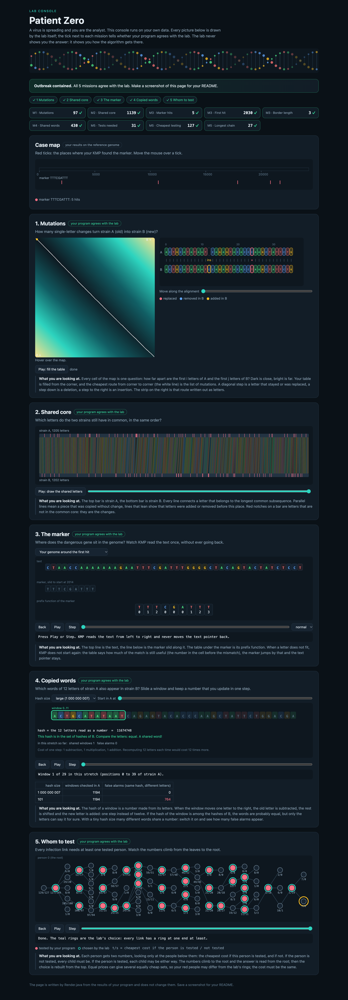

# Assignment 4. Patient Zero

Student ID: 252609
Name: Ramil Zhunussov
Group: SE-2510

This file is the report. Fill it in as you go. How to start: `START_HERE.md`. The task: `docs/Assignment4.pdf`.

## Program output

The 9 lines your program prints on your data (`java -cp out Main`):

    Mutations: 97
    Shared core: 1139
    Marker hits: 5
    First hit: 2030
    Border length: 3
    Shared words: 430
    Tests needed: 31
    Cheapest testing: 127
    Longest chain: 27

`java tools/Check.java` shows all 9 lines right on `tiny`, `small` and `dense`, and the lab console shows a tick on all 9 lines ("Outbreak contained"). On my data the program finishes in well under a second.

My outbreak report (a screenshot of `output/outbreak.html`):

## Questions

Mission 1. What does the cell d[i][j] of your table mean, and how is it computed from other cells?

d[i][j] is the smallest number of changes that turn the first i letters of A into the first j letters of B. The first column is d[i][0] = i (delete all i letters) and the first row is d[0][j] = j (insert all j letters). For the other cells the last step is one of three: replace or keep the last letter, d[i-1][j-1] + (0 if A[i-1] = B[j-1], else 1); delete A[i-1], d[i-1][j] + 1; or insert B[j-1], d[i][j-1] + 1. The cell takes the minimum of the three, and the answer is the bottom-right cell d[n][m] = 97 for my strains.

Mission 2. How is the longest common subsequence different from the longest common substring? My Shared core is bigger than the number of letters that are the same at the same place: why?

A substring must be one unbroken piece in both strings, a subsequence only has to keep the order: its letters may have gaps between them. The table is the same shape as in Mission 1: if A[i-1] = B[j-1] then L[i][j] = L[i-1][j-1] + 1, otherwise L[i][j] = max(L[i-1][j], L[i][j-1]). Only 349 of my 1202 positions have the same letter at the same index, but the Shared core is 1139: one inserted or deleted letter shifts everything after it by one place, so the comparison "at the same place" breaks after the first indel, while the LCS can skip the extra letter and line the rest up again.

Mission 3. What does the prefix function tell you, and why does the pointer in the text never go back in KMP? What is the Border length of my marker and what does it mean?

pi[i] is the length of the longest proper prefix of p[0..i] that is also a suffix of it (the longest border). In KMP, when k letters are matched and the next letter does not fit, the last pi[k-1] letters of the text that we already read are equal to the first pi[k-1] letters of the marker, so we can continue from k = pi[k-1] without reading those letters again: the text pointer only moves forward and the search is O(n + m). My marker is TTTCGATTT with pi = [0, 1, 2, 0, 0, 0, 1, 2, 3], so the Border length is 3: "TTT" is both the beginning and the end of the marker. After a full match KMP goes on with k = 3, so a next occurrence that starts on the last TTT of this one (an overlap) is not missed. In my genome the marker occurs 5 times, first at position 2030.

Mission 4. Why must you compare the letters after the hashes are equal? What happens to the cost of Rabin-Karp if many windows have the same hash?

A hash maps 4^12 (about 16.8 million) possible words into numbers modulo MOD, so two different words can get the same hash (a collision). Equal hashes only say "maybe equal", so I compare the 12 letters before I count the position; otherwise every collision would be counted as a shared word. With my MOD = 1 000 000 007 collisions are very rare, but with a tiny MOD = 101 every one of the 1194 windows of A has its hash among the windows of B, and only the letter check keeps the answer at 430 (the same as with the big MOD). If many windows share a hash, almost every lookup becomes a letter comparison against many candidates, so the time goes from about O(n + m) up to O(n * m * k) in the worst case.

Mission 5. What are the two states of a person in your DP, and how do you get the answer for a person from its children? Why does a greedy "test the person with most links first" not always give the cheapest answer?

I root the tree in person 0 and for every person v keep two numbers about the subtree of v: in[v], the cheapest cost when v is tested, and out[v], the cheapest cost when v is not tested. If v is tested, every link to a child is already covered, so each child takes the cheaper of its two states: in[v] = cost[v] + sum of min(in[c], out[c]). If v is not tested, the link v-c must be covered by the child, so out[v] = sum of in[c]. The answer is min(in[0], out[0]), and I rebuild who is tested by walking down from the root: a child of an untested person must be tested, a child of a tested person takes its cheaper state. Greedy fails on a simple spider: a centre with three legs of length two (centre - a1 - b1, centre - a2 - b2, centre - a3 - b3). Greedy tests the centre first (3 links) and then still needs one person on every leg, 4 tests, while a1, a2, a3 cover all 6 links with 3 tests. With costs it is even worse: a star whose centre costs 100 and whose 3 leaves cost 1 each, greedy pays 100 and the DP pays 3.

The longest chain uses down[v], the longest way from v down into its subtree; the longest chain that turns at v is the sum of the two longest ways down through different children, and the answer (27 links for my tree of 77 people) is the maximum over all v.

## AI use

I used Claude (Anthropic, through Claude Code). It wrote the code of Missions 1 to 5 from the comments in the starter files and Hints.md, checked it against `java tools/Check.java` and against brute-force solutions on random small inputs, took the screenshot of the lab console, ran Bench, and drafted the answers in this README. No code or text was taken from a book or a website.

## Timing (Mission 7)

Milliseconds, average of 3 runs, from `java -cp out Bench`.

| test | size | time |
|---|---|---|
| naive search | 20 000 / 40 000 / 80 000 | 20.4 / 56.6 / 116.1 |
| KMP | 20 000 / 40 000 / 80 000 | 1.2 / 0.5 / 0.2 |
| edit distance | 500 / 1000 / 2000 / 4000 | 3.9 / 3.8 / 8.3 / 43.2 |

The naive search roughly doubles when the text doubles (20 -> 57 -> 116 ms), because with a pattern of 2000 letters every start position compares almost 2000 letters: O(n * m) with m fixed. KMP is O(n + m) and so fast here that the numbers mostly show JIT warm-up (the first run is the slowest), not the growth. Edit distance is O(n^2): from 2000 to 4000 the time grows about 5 times (close to the expected 4 times; the 64 MB table no longer fits in the cache), while for 500 and 1000 the times are too small and are hidden by the warm-up.

## Complexity

n is the length of the text (or of a strain), m the length of the pattern, k the length of the window, v the number of people. Fill in every algorithm you wrote.

| algorithm | time | space | assumptions |
|---|---|---|---|
| Edit distance | O(n * m) | O(n * m) | full (n+1) x (m+1) table, every cell in O(1) from 3 neighbours; two rows would be enough for the number only (O(m) space) |
| LCS | O(n * m) | O(n * m) | same table, every cell in O(1) from 3 neighbours |
| Prefix function and KMP | O(n + m) | O(m) (+ the list of hits) | pi in O(m), the search in O(n): k grows by at most 1 per letter and every fall-back makes it smaller, so the total number of steps is linear |
| Rabin-Karp (shared words) | O(n + m) expected, O(n * m * k) worst case | O(n + m) | hashes of all windows in O(n + m) by rolling, a hash map lookup in O(1) on average, k letters compared on a hash hit; the worst case is when almost all windows have the same hash |
| Tree DP | O(v) | O(v) | every person and every link is visited a constant number of times (BFS from person 0, one pass up for in/out and the longest chain, one pass down to rebuild who is tested) |
